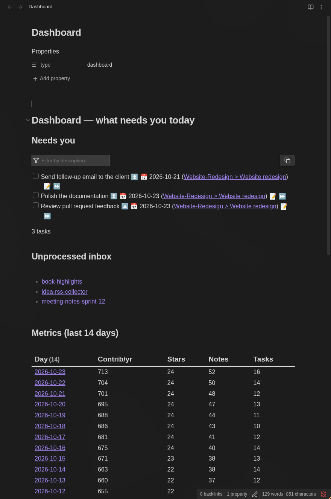
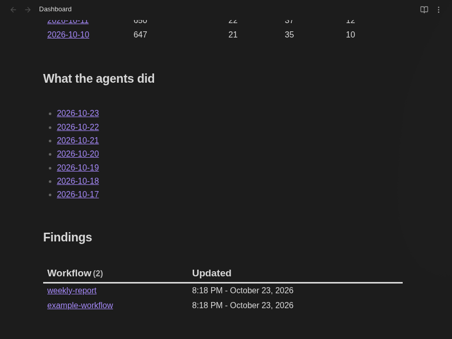

# Obsidian Backend Template

Turn an Obsidian vault into a **backend that feeds you** instead of a second brain you have to feed forever.

Plain Markdown files, no database, no cloud. Scheduled scripts write real numbers into daily notes, AI agents log their own work, and a dashboard note shows what needs you today.

Inspired by the ideas in [Build an Obsidian BACKEND Not a Second Brain!](https://www.youtube.com/watch?v=4z2i6UsQG1k) by Eric Michaud; this is an independent implementation.

## Preview

Dashboard rendered in Obsidian with **demo data** (nothing here comes from a real vault):




## The problem

Second-brain setups collect notes and then collect dust. AI agents make it worse: given a whole vault they drown in context, and they happily "summarize" ideas you wanted kept verbatim. Metrics get typed by hand (or estimated by a model) and drift from reality.

## The approach

| Idea | How it is implemented |
|---|---|
| **Human vs machine zones** | `Human/` is yours; agents only write there when asked. `Machine/` is theirs. |
| **Frontmatter as a database** | `Machine/Metrics/YYYY-MM-DD.md`: one note per day, one property per metric. Dataview queries turn them into tables. |
| **Deterministic metrics** | Collectors (`Machine/Collectors/`) write the numbers from real sources. A failing collector leaves the value empty, never an estimate. |
| **`AGENTS.md` in every folder** | An agent reads the root map, then only the folder it works in. Less context, better answers. |
| **Findings that compound** | `Machine/Findings/<workflow>.md` is read before and updated after each run, so workflows improve. |
| **Agent activity log** | Agents append to `Machine/Logs/`; the daily note embeds today's log. |

## Quick start

```bash
git clone <this-repo> my-vault
cd my-vault
pip install pytest && pytest -q         # 9 tests
gh auth login                           # only needed for the GitHub collector
python3 Machine/Collectors/run_all.py   # fills today's metrics + log
./install-timer.sh                      # optional: run daily at 08:00 (systemd user timer)
```

Then open the folder as a vault in Obsidian and install the plugins listed in [docs/PLUGINS.md](docs/PLUGINS.md). Open `Dashboard.md`.

Full walkthrough: [docs/TUTORIAL.md](docs/TUTORIAL.md).

## Layout

```
AGENTS.md            vault map and rules for agents
Dashboard.md         front end (Dataview + Tasks)
Human/               your notes (Inbox, Daily, Projects, Templates)
Machine/
  Collectors/        python scripts + systemd timer
  Metrics/           daily metric notes (frontmatter)
  Logs/              daily agent activity
  Findings/          lessons per workflow
tests/               pytest suite for collectors
```

## Privacy

Daily metrics, logs and daily notes are git-ignored by default, so your numbers and journal stay local. Collectors never read note contents, only counts, mtimes and `- [ ]` lines in `Human/`.

## Requirements

Python 3.10+, [Obsidian](https://obsidian.md), `gh` CLI (GitHub collector only). Timer script targets Linux/systemd; on macOS use `launchd`/`cron` to run `run_all.py`.

## License

MIT
